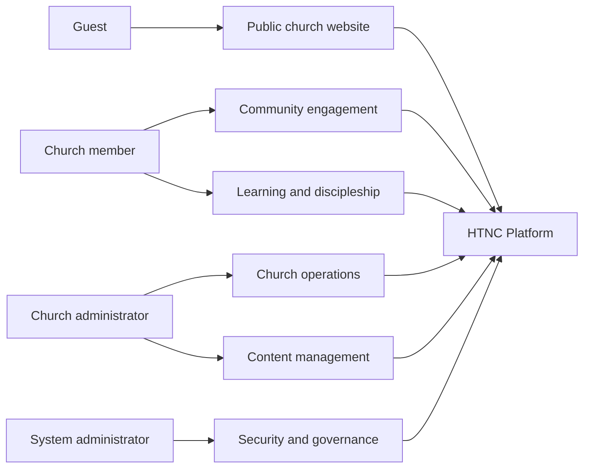
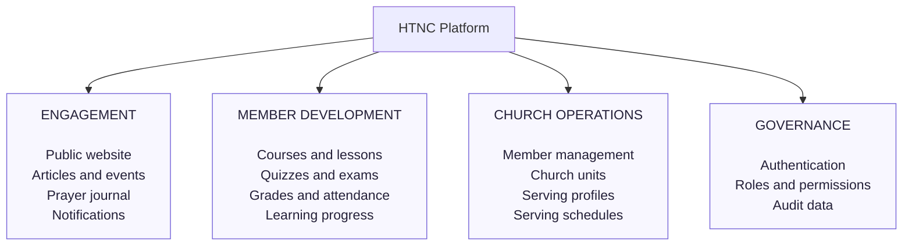
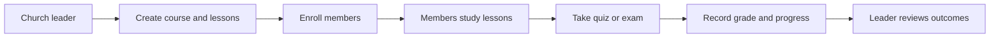
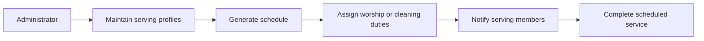
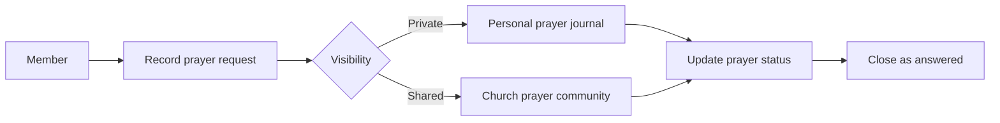
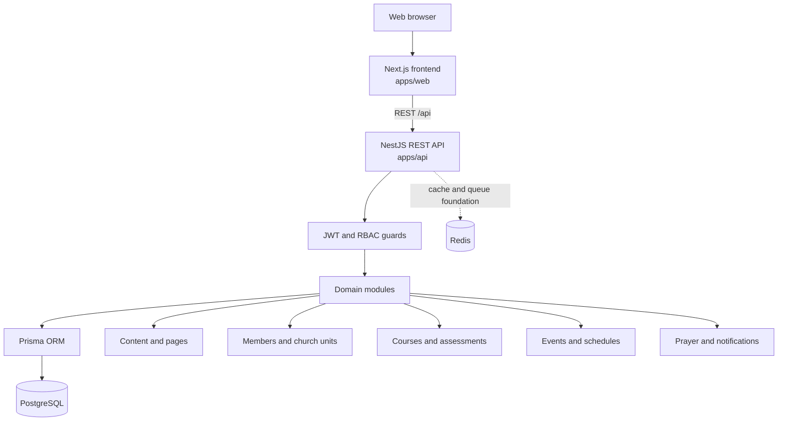
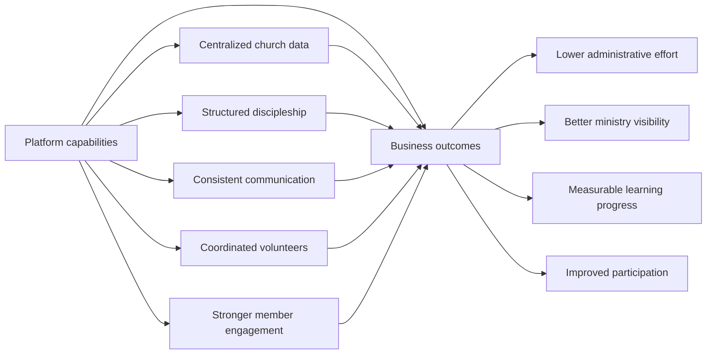

# HTNC Platform — High-Level Business Report

## Executive summary

HTNC is a bilingual Vietnamese/English church management platform. It combines a public website, content management, member administration, online learning, events, prayer activities, volunteer scheduling, and notifications in one system.

At the business level, the platform supports four primary goals:

- Communicate church information and teaching content.
- Develop members through structured courses and assessments.
- Organize members, ministries, events, and serving teams.
- Strengthen community engagement through prayer and notifications.

## Business modules

| Module | Business capability |
|---|---|
| Authentication and RBAC | Login, session refresh, password changes, roles, and permissions |
| CMS and page builder | Build public pages, manage navigation, publish content, and restore deleted pages |
| Articles | Publish church news, teaching materials, announcements, and categorized content |
| Courses and learning | Manage courses, lessons, enrollment, question templates, quizzes, exams, grades, attendance, and progress |
| Members | Maintain member profiles and administrative member records |
| Church units | Organize departments, ministries, groups, unit membership, and class scores |
| Events | Manage categories, schedules, recurring events, target groups, attendance data, and calendar feeds |
| Prayer journal | Record private or shared prayers, categorize requests, share them, and track answered prayers |
| Serving schedules | Manage worship and cleaning teams, serving profiles, assignments, and generated schedules |
| Notifications | Send targeted messages, list notifications, and track read status |
| Administration | Manage pages, menus, articles, courses, tests, church units, and serving schedules |

## Primary users

### Guest

- View public pages and church information.
- Read public articles.
- View public events.

### Church member

- Access member-only content.
- Enroll in courses and complete lessons.
- Take quizzes and exams and review progress.
- Create private or shared prayer entries.
- View events and notifications.

### Church administrator

- Manage website content and navigation.
- Maintain members and church units.
- Create courses, lessons, tests, and enrollments.
- Manage events and serving schedules.
- Moderate shared church content.

### System administrator

- Manage system-level access and permissions.
- Oversee sensitive data and system configuration.
- Support audits, integrations, backups, and security operations.

## Core business workflows

## Technical architecture

The application uses a domain-oriented modular monolith in a pnpm monorepo.

### Technology summary

- Frontend: Next.js
- Backend: NestJS REST API
- Database: PostgreSQL with Prisma
- Infrastructure: Redis bootstrap, Docker Compose, and Adminer
- Security: JWT authentication and database-backed roles and permissions
- Languages: Vietnamese and English
- Public content: Database-driven page builder and dynamic route resolution

## Business assessment

The platform is broader than a standard church website. Its intended position is a lightweight **church management system, learning management system, and content management system**.

The learning module is currently the deepest business area. Its model and API cover enrollment, lessons, reusable question templates, quizzes, attempts, grading, attendance, and learning progress.

The current maturity is best described as an **active MVP or early operational product**:

- Core domain APIs and administrative screens exist.
- Some frontend mock data and placeholder content remain.
- Some database capabilities, including households and parts of attendance and audit reporting, do not yet have complete user-facing workflows.
- RBAC infrastructure exists, but detailed backend permission enforcement is not yet consistent across every module.
- The administrative dashboard contains static or translated summary values rather than complete live business analytics.
- Continuous integration is still listed as pending.

## Business value

## Recommended priorities

1. Complete member and household management workflows.
2. Apply consistent backend permissions to every administrative operation.
3. Add operational reports for attendance, course completion, serving workload, and member engagement.
4. Replace remaining mock and static data with production API data.
5. Strengthen audit visibility, backups, privacy controls, and automated testing before scaling sensitive member and prayer data.

## Source references

- `README.md`
- `apps/api/src/app.module.ts`
- `apps/api/prisma/schema.prisma`
- `apps/web/src/app`
- `apps/web/src/components/admin/AdminLayout.tsx`
- `docs/system-rbac-define.md`
